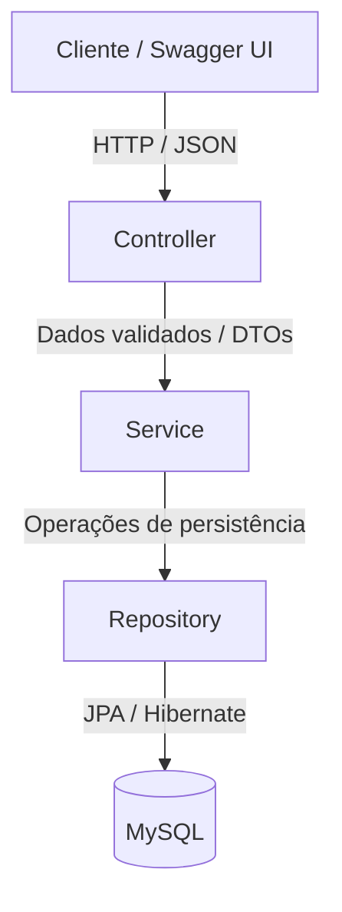

# AutoParts ERP — Backend API

[](https://www.oracle.com/java/)
[](https://spring.io/projects/spring-boot)
[](https://www.mysql.com/)
[](http://localhost:8080/swagger-ui.html)
[](LICENSE)

API REST para um sistema de gestão empresarial voltado ao segmento de autopeças, desenvolvida com **Java**, **Spring Boot** e **MySQL**.

O projeto utiliza arquitetura em camadas, DTOs, validação de dados e documentação interativa com Swagger UI.

---

## Sumário

- [Sobre o projeto](#sobre-o-projeto)
- [Funcionalidades disponíveis](#funcionalidades-disponíveis)
- [Arquitetura](#arquitetura)
- [Tecnologias](#tecnologias)
- [Roadmap](#roadmap)
- [Endpoints](#endpoints)
- [Como executar](#como-executar)
- [Exemplos de uso](#exemplos-de-uso)
- [Validação manual](#validação-manual)
- [Autor](#autor)
- [Licença](#licença)

## Sobre o projeto

O **AutoParts ERP** tem como objetivo apoiar as operações do varejo automotivo, reunindo funcionalidades de catálogo de peças, controle de estoque, relacionamento comercial e vendas.

A API foi estruturada para permitir o consumo por aplicações web, mobile e desktop, mantendo a interface do usuário separada das regras de negócio e da persistência dos dados.

**O estágio atual contempla os módulos de Gestão de Peças e Catálogo e Controle de Estoque e Movimentações.** Os demais módulos estão previstos no roadmap.

## Funcionalidades disponíveis

- Cadastro de peças.
- Listagem das peças cadastradas.
- Consulta de uma peça pelo identificador.
- Atualização completa dos dados de uma peça.
- Exclusão de peças do catálogo.
- Registro de marca, código de barras e descrição de modelos compatíveis.
- Cadastro de preços de custo e venda.
- Registro da quantidade inicial em estoque no cadastro da peça.
- Registro de entradas e saídas com atualização automática do saldo.
- Bloqueio de saídas com quantidade superior ao saldo disponível.
- Histórico geral de movimentações e extrato por peça, com tipo, quantidade, motivo e data/hora.
- Consulta de peças com estoque baixo, com limite configurável (padrão: 5 unidades).
- Validação dos dados recebidos pela API.
- Persistência dos dados em MySQL.
- Documentação e execução de requisições pelo Swagger UI.

> O cadastro e a atualização de peças permitem informar o saldo diretamente, sem gerar histórico. Para registrar entradas e saídas no histórico, utilize os endpoints de movimentações.

## Arquitetura

A aplicação utiliza **arquitetura em camadas**, com separação de responsabilidades entre a exposição dos endpoints, as regras de negócio e o acesso ao banco de dados.



### Responsabilidades

| Componente | Responsabilidade |
| --- | --- |
| **Controller** | Receber requisições HTTP, acionar a validação dos dados de entrada e retornar respostas. |
| **Service** | Executar regras de negócio e definir os limites das transações. |
| **Repository** | Realizar consultas e operações de persistência com Spring Data JPA. |
| **Entity** | Representar as entidades persistidas e seus mapeamentos no banco de dados. |
| **DTO** | Definir os dados utilizados nas requisições e respostas da API. |

### Práticas aplicadas

- **Separação de responsabilidades:** organização do código por camadas.
- **DTOs:** definição dos contratos de entrada e saída, reduzindo a exposição direta das entidades.
- **Bean Validation:** verificação de restrições nos dados recebidos, conforme as anotações configuradas.
- **Transações:** uso de `@Transactional` nas operações que exigem controle transacional.
- **Documentação interativa:** descrição e execução dos endpoints com Springdoc OpenAPI e Swagger UI.

> A validação verifica restrições dos dados. Ela não substitui a sanitização de conteúdo quando essa proteção for necessária.

## Tecnologias

| Categoria | Tecnologia | Versão informada |
| --- | --- | --- |
| Linguagem | Java | 21 |
| Framework | Spring Boot | 4.1.2 |
| Acesso a dados | Spring Data JPA | Gerenciada pelo Spring Boot |
| ORM | Hibernate ORM | Gerenciada pelo Spring Boot |
| Banco de dados | MySQL | 8.0+ |
| Validação | Jakarta Bean Validation | Gerenciada pelo Spring Boot |
| Documentação | Springdoc OpenAPI / Swagger UI | 2.5.0 |
| Build e dependências | Apache Maven | 3.10.0 no Wrapper |

> As versões de Java, Spring Boot e Springdoc estão declaradas no `pom.xml`. A distribuição do Maven Wrapper está definida em `.mvn/wrapper/maven-wrapper.properties`; a versão mínima do MySQL não é fixada pelo projeto.

## Roadmap

- [x] **Módulo 1 — Gestão de Peças e Catálogo**
    - CRUD de peças, DTOs, validações e persistência em MySQL.
- [x] **Módulo 2 — Controle de Estoque e Movimentações**
    - Entradas, saídas, histórico de movimentações e alertas de estoque mínimo.
- [ ] **Módulo 3 — Gestão de Clientes e Fornecedores**
    - Cadastros e vínculos comerciais.
- [ ] **Módulo 4 — Vendas e Pedidos**
    - Itens de venda, fechamento de pedidos e regras de desconto.
- [ ] **Módulo 5 — Dashboard e Relatórios**
    - Indicadores de vendas, relatórios financeiros e curva ABC de estoque.

## Endpoints

**URL base do ambiente local:**

```text
http://localhost:8080
```

### Peças

| Método | Rota | Descrição | Resposta de sucesso |
| --- | --- | --- | --- |
| `POST` | `/api/pecas` | Cadastrar uma peça. | `201 Created` |
| `GET` | `/api/pecas` | Listar as peças cadastradas. | `200 OK` |
| `GET` | `/api/pecas/{id}` | Consultar uma peça pelo ID. | `200 OK` |
| `PUT` | `/api/pecas/{id}` | Atualizar todos os dados de uma peça. | `200 OK` |
| `DELETE` | `/api/pecas/{id}` | Excluir uma peça pelo ID. | `204 No Content` |

> O endpoint `PUT` representa uma atualização completa. Envie todos os campos exigidos pelo DTO de atualização.

### Estoque e movimentações

| Método | Rota | Descrição | Resposta de sucesso |
| --- | --- | --- | --- |
| `POST` | `/api/movimentacoes` | Registrar entrada ou saída e atualizar o saldo. | `201 Created` |
| `GET` | `/api/movimentacoes` | Listar o histórico geral. | `200 OK` |
| `GET` | `/api/movimentacoes/peca/{pecaId}` | Consultar o histórico da peça, do mais recente ao mais antigo. | `200 OK` |
| `GET` | `/api/movimentacoes/alertas-estoque-baixo` | Listar peças com saldo menor ou igual ao limite. | `200 OK` |

O parâmetro opcional `limiteMinimo` define o limite da consulta de estoque baixo. Exemplo: `/api/movimentacoes/alertas-estoque-baixo?limiteMinimo=10`. Sem o parâmetro, o limite é `5`. Os alertas são retornados na consulta, sem envio de notificações.

### Regras e validações

- **Peças:** nome, código de barras, marca, preços e quantidade em estoque são obrigatórios. O nome aceita até 100 caracteres, os preços devem ser de pelo menos `0.01` e o estoque não pode ser negativo. O modelo compatível é opcional.
- **Código de barras:** deve ser único no banco; o cadastro também verifica duplicidade no serviço.
- **Movimentações:** `pecaId`, `tipo`, `quantidade` e `motivo` são obrigatórios. O tipo deve ser `ENTRADA` ou `SAIDA`, a quantidade deve ser de pelo menos `1` e o motivo não pode estar em branco. No banco, o motivo aceita até 150 caracteres.
- **Saldo:** entradas somam e saídas subtraem a quantidade. Uma saída superior ao saldo disponível é rejeitada. A atualização do saldo e o registro do histórico ocorrem na mesma transação.
- **Histórico:** `estoqueAtualizadoPeca` representa o saldo atual da peça no momento da consulta; não armazena o saldo histórico de cada movimentação.
- **Exclusão:** peças vinculadas a movimentações podem ter a exclusão impedida pela integridade referencial do banco.

> As regras de negócio lançam `RuntimeException` e ainda não possuem tratamento centralizado para respostas como `404 Not Found` ou `409 Conflict`. Esses casos podem retornar `500 Internal Server Error`.

Os schemas e as restrições de cada operação podem ser consultados na documentação interativa.

## Como executar

### 1. Pré-requisitos

Instale e configure:

- **JDK 21**, conforme o `pom.xml`.
- **MySQL Server 8.0+**.
- **Git**.
- **Maven Wrapper incluído no repositório**, ou uma instalação compatível do Maven.
- Uma IDE de sua preferência, como IntelliJ IDEA, Eclipse ou VS Code.

Verifique a instalação do Java:

```bash
java -version
```

Caso utilize o Maven instalado na máquina:

```bash
mvn -version
```

### 2. Clonar o repositório

Clone o repositório:

```bash
git clone https://github.com/Glegorio/AutoPartsERP.git
cd AutoPartsERP
```

### 3. Criar o banco de dados

No MySQL Workbench, DBeaver ou terminal do MySQL, execute:

```sql
CREATE DATABASE IF NOT EXISTS auto_pecas_db
    CHARACTER SET utf8mb4;
```

Certifique-se de que o usuário utilizado pela aplicação tenha permissão para acessar e alterar esse banco no ambiente local.

### 4. Configurar a aplicação

A configuração existente está no arquivo:

```text
src/main/resources/application.properties
```

O arquivo atual contém credenciais locais diretamente nas propriedades. Para utilizar as variáveis `DB_URL`, `DB_USERNAME` e `DB_PASSWORD` descritas abaixo, substitua as configurações pelo exemplo:

```properties
# Identificação da aplicação
spring.application.name=erp-auto-parts

# Servidor HTTP
server.port=8080

# Conexão com o banco de dados
spring.datasource.url=${DB_URL:jdbc:mysql://localhost:3306/auto_pecas_db?serverTimezone=UTC}
spring.datasource.username=${DB_USERNAME}
spring.datasource.password=${DB_PASSWORD}

# JPA / Hibernate — desenvolvimento local
spring.jpa.hibernate.ddl-auto=update
spring.jpa.show-sql=true
spring.jpa.properties.hibernate.format_sql=true

# Documentação
springdoc.swagger-ui.path=/swagger-ui.html
```

Configure as variáveis de ambiente antes de iniciar a aplicação:

| Variável | Descrição | Obrigatória |
| --- | --- | --- |
| `DB_USERNAME` | Usuário do MySQL. | Sim |
| `DB_PASSWORD` | Senha do usuário do MySQL. | Sim |
| `DB_URL` | URL JDBC do banco de dados. | Não; utiliza a conexão local configurada como padrão. |

#### IntelliJ IDEA

Acesse:

**Run → Edit Configurations → configuração da aplicação → Environment variables**

Cadastre `DB_USERNAME` e `DB_PASSWORD` com as credenciais do seu ambiente.

> Não versione senhas no repositório. A configuração acima utiliza variáveis do sistema operacional ou da configuração de execução da IDE; um arquivo `.env` não é carregado automaticamente por ela.

> `spring.jpa.hibernate.ddl-auto=update` é utilizado aqui para facilitar o desenvolvimento local. Para ambientes compartilhados ou de produção, adote migrações versionadas com ferramentas como Flyway ou Liquibase.

### 5. Executar a aplicação

Com o MySQL em execução e as variáveis de ambiente configuradas, utilize uma das opções abaixo.

#### Linux / macOS — Maven Wrapper

```bash
./mvnw spring-boot:run
```

#### Windows PowerShell — Maven Wrapper

```powershell
.\mvnw.cmd spring-boot:run
```

#### Maven instalado

```bash
mvn spring-boot:run
```

Também é possível executar a classe principal `ErpApplication.java` pela IDE.

> O repositório inclui o Maven Wrapper. A primeira execução requer acesso à internet para baixar o Maven e as dependências.

### 6. Acessar a documentação

Com a aplicação iniciada, acesse:

| Recurso | Endereço |
| --- | --- |
| Swagger UI | [http://localhost:8080/swagger-ui.html](http://localhost:8080/swagger-ui.html) |
| Especificação OpenAPI | [http://localhost:8080/v3/api-docs](http://localhost:8080/v3/api-docs) |

## Exemplos de uso

### Cadastrar uma peça

**Requisição:**

```http
POST /api/pecas
Content-Type: application/json
```

```json
{
  "nome": "Pastilha de Freio Dianteira",
  "codigoBarra": "7891234567890",
  "marca": "Fras-le",
  "modeloCompativel": "Gol G5 / Voyage 1.6 2010+",
  "precoCusto": 45.50,
  "precoVenda": 89.90,
  "quantidadeEstoque": 25
}
```

**Exemplo de resposta — `201 Created`:**

```json
{
  "id": 1,
  "nome": "Pastilha de Freio Dianteira",
  "codigoBarra": "7891234567890",
  "marca": "Fras-le",
  "modeloCompativel": "Gol G5 / Voyage 1.6 2010+",
  "precoCusto": 45.50,
  "precoVenda": 89.90,
  "quantidadeEstoque": 25
}
```

> O identificador é gerado pelo banco de dados e pode ser diferente do exemplo.

### Consultar uma peça

```http
GET /api/pecas/1
```

### Atualizar uma peça

**Requisição:**

```http
PUT /api/pecas/1
Content-Type: application/json
```

```json
{
  "nome": "Pastilha de Freio Dianteira",
  "codigoBarra": "7891234567890",
  "marca": "Fras-le",
  "modeloCompativel": "Gol G5 / Voyage 1.6 2010+",
  "precoCusto": 48.00,
  "precoVenda": 94.90,
  "quantidadeEstoque": 30
}
```

**Resposta de sucesso:** `200 OK`.

### Registrar uma entrada de estoque

Após cadastrar a peça, utilize o identificador retornado:

```http
POST /api/movimentacoes
Content-Type: application/json
```

```json
{
  "pecaId": 1,
  "tipo": "ENTRADA",
  "quantidade": 10,
  "motivo": "Reposição de estoque"
}
```

**Exemplo de resposta — `201 Created`:**

```json
{
  "id": 1,
  "pecaId": 1,
  "nomePeca": "Pastilha de Freio Dianteira",
  "tipo": "ENTRADA",
  "quantidade": 10,
  "motivo": "Reposição de estoque",
  "dataHora": "2026-10-27T10:30:00",
  "estoqueAtualizadoPeca": 40
}
```

> O saldo `40` considera a atualização anterior para `30` unidades. Os identificadores e a data/hora são ilustrativos e gerados pela aplicação ou pelo banco.

### Registrar uma saída de estoque

```http
POST /api/movimentacoes
Content-Type: application/json
```

```json
{
  "pecaId": 1,
  "tipo": "SAIDA",
  "quantidade": 3,
  "motivo": "Venda no balcão"
}
```

**Resposta de sucesso:** `201 Created`. No fluxo acima, o saldo passa de `40` para `37` unidades.

### Consultar histórico e estoque baixo

```http
GET /api/movimentacoes
```

```http
GET /api/movimentacoes/peca/1
```

```http
GET /api/movimentacoes/alertas-estoque-baixo?limiteMinimo=5
```

### Excluir uma peça

```http
DELETE /api/pecas/1
```

**Resposta de sucesso:** `204 No Content`, sem corpo de resposta. Utilize uma peça sem movimentações vinculadas para este exemplo.

## Validação manual

Utilize o Swagger UI para verificar o fluxo principal:

1. Cadastre uma peça com `POST /api/pecas`.
2. Anote o `id` retornado.
3. Consulte a listagem com `GET /api/pecas`.
4. Consulte o registro com `GET /api/pecas/{id}`.
5. Atualize o cadastro com `PUT /api/pecas/{id}`, enviando todos os campos exigidos.
6. Consulte novamente para conferir a persistência das alterações.
7. Registre uma entrada de `10` unidades com `POST /api/movimentacoes` e confira o aumento do saldo.
8. Registre uma saída de `3` unidades e confira a redução do saldo.
9. Consulte o histórico geral e o extrato da peça; no extrato, confira a ordem decrescente de data/hora.
10. Tente registrar uma saída superior ao saldo disponível e confirme que o saldo e o histórico não foram alterados.
11. Consulte os alertas com um limite igual ao saldo atual e, depois, com um limite menor; confira a inclusão e a exclusão da peça no resultado.
12. Crie outra peça, sem movimentações, exclua-a com `DELETE /api/pecas/{id}` e confira se deixou de aparecer na listagem.

Verifique também as restrições declaradas nos DTOs, enviando valores inválidos e conferindo as respostas da API.

## Autor

**Vitor Gabriel dos Reis Glegorio** — [GitHub](https://github.com/Glegorio).

## Licença

Este projeto está sob a licença **MIT**.

Consulte o arquivo [LICENSE](LICENSE) para conhecer os termos de uso, cópia, modificação e distribuição.